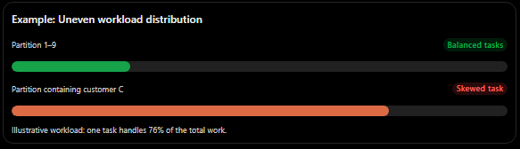
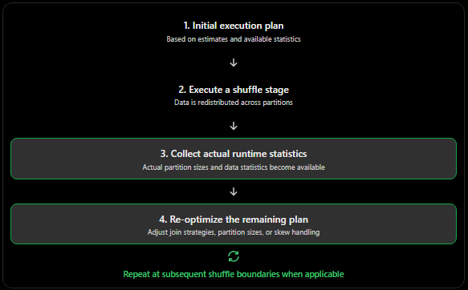
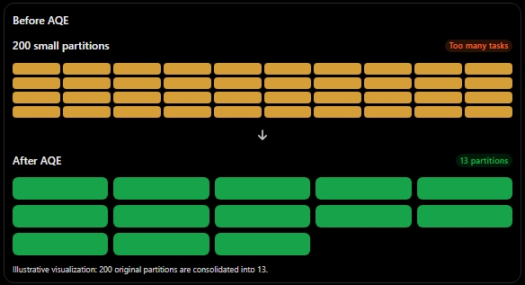
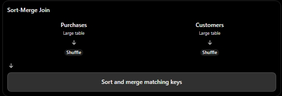
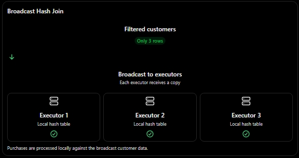
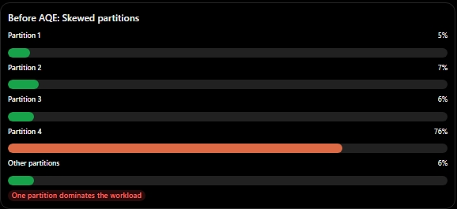
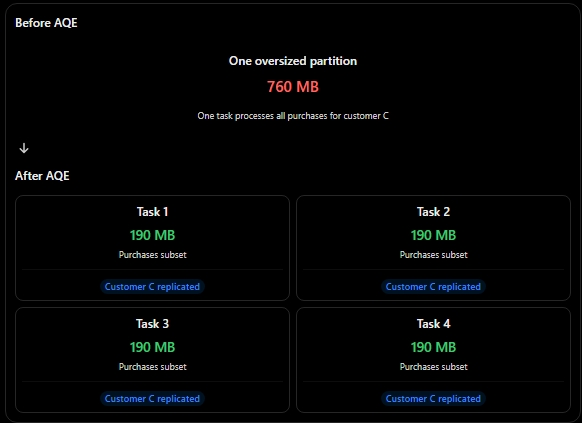

# Adaptive Query Execution (AQE)

The execution plan that adapts while running.

Spark normally creates an execution plan before processing the actual data. However, this plan relies on estimates that may be inaccurate, especially when filters significantly reduce the data or when data is unevenly distributed (data skew).

Adaptive Query Execution (AQE) solves this problem by allowing Spark to revise its physical execution plan while a query is running. It uses actual runtime statistics collected at shuffle boundaries to make better decisions about the remaining execution.

## Lazy Evaluation: Spark's To-Do List

Spark does not immediately execute transformations. Instead, it builds a logical plan describing the operations that need to be performed.

```python
result = purchases.join(customers, "customer_id")
```

Defines a join between `purchases` and `customers`. No data is processed yet.

```python
result = result.filter(result.value > 50)
```

Adds a filter to the plan. Spark records that only rows where `value > 50` should be kept.

```python
result.show()
```

Triggers execution because `show()` needs actual rows to display.

### Transformations: Operations that build the plan

Transformations describe what Spark should do, but do not immediately execute the computation.

Examples:

- `join()`
- `filter()`
- `select()`
- `groupBy()`
- `withColumn()`

### Actions: Operations that trigger execution

Actions require actual results, causing Spark to execute the necessary parts of the plan.

Examples:

- `show()`
- `count()`
- `collect()`
- `write()`

Exam note: Transformations are lazy, but they are not necessarily ignored until an action occurs. Spark can perform analysis and detect errors earlier. For example, if `customer_id` does not exist, Spark may raise an analysis error when the plan is constructed or analyzed, before `show()` is called.

## What Happens When an Action Is Triggered?

When an action is called, Spark moves from describing the computation to executing it.

### Step 1: Planning the execution

The driver analyzes the logical plan, applies optimizations, and generates a physical execution plan.

It determines things such as:

- Which join strategy to use (Broadcast Hash Join, Sort-Merge Join, etc.).
- Whether a shuffle is required.
- How many shuffle partitions to create.
- How data should be distributed across executors.

The driver then schedules tasks for the executors.

### Step 2: Processing the data

The executors read and process the data according to the physical plan.

For example, during a shuffle, Spark redistributes records based on their partitioning key.

Conceptually:

```python
partition_id = hash(customer_id) % 200
```

Records with the same partitioning key are sent to the same shuffle partition, allowing the join to be performed correctly.

Why this matters: Without AQE, Spark generally relies on its initial physical plan, even if runtime conditions reveal that a different strategy would be more efficient.

For example, Spark might initially choose to shuffle both tables instead of broadcasting a smaller table. If the actual data size turns out to be much smaller than estimated, the original decision may have been inefficient.

## Estimation Without Reading the Actual Data

Before execution, Spark uses available metadata and statistics to estimate how much data it will process and how expensive different execution strategies might be.

These estimates help Spark choose an initial physical plan, but they are not always accurate.

| What Spark can estimate                                                                                               | What it may not know accurately                                                                                           |
| --------------------------------------------------------------------------------------------------------------------- | ------------------------------------------------------------------------------------------------------------------------- |
| File sizes: Storage metadata can indicate that `customers` occupies 211 MB and `purchases` occupies 1.2 GB.           | Filtered data size: If Spark applies `country == "Colombia"`, it may not know how many rows will remain after filtering.  |
| Stored statistics: Delta Lake can provide statistics such as row counts, minimum and maximum values, and null counts. | Data distribution: Spark may not know that one customer accounts for most purchases, creating a heavily skewed partition. |
| Filter conditions: Spark can estimate filter selectivity using available statistics and optimizer rules.              | Actual partition sizes: Before the shuffle, Spark cannot know the exact size of each resulting partition.                 |

### 1. File sizes vs. filtered data size

Spark can obtain file-size information without reading the entire contents of those files.

However, knowing that a table occupies 211 MB does not tell Spark how much data will remain after applying a filter.

For example:

```python
customers.filter(customers.country == "Colombia")
```

The result could contain 3 rows or 3 million rows.

If Spark lacks useful statistics about `country`, its initial estimate may be inaccurate.

### 2. Stored statistics vs. data skew

Delta Lake can maintain file-level statistics that help Spark estimate data characteristics and skip unnecessary files.

However, these statistics do not necessarily reveal how frequently individual values occur across the entire dataset.

For example, one customer might account for 80% of all purchases.

This creates data skew: some partitions contain significantly more data than others, causing certain tasks to take much longer.

### 3. Filter estimation vs. actual filter results

Spark can estimate how many records a filter will eliminate when sufficient statistics are available.

However, without useful statistics, it may rely on default selectivity assumptions or other estimation heuristics.

The Cost-Based Optimizer (CBO) can improve these estimates using available statistics.

Relevant configuration:

```python
spark.conf.set("spark.sql.cbo.enabled", "true")
```

Note: CBO is disabled by default in standard Spark configurations. Enabling it does not automatically provide accurate statistics; those statistics must also be collected and available.

### 4. Shuffle partitions vs. actual partition sizes

Spark commonly starts with 200 shuffle partitions by default:

```python
spark.sql.shuffle.partitions = 200
```

This is a configurable default, not a fixed requirement.

Before the shuffle, Spark cannot know the exact amount of data each partition will contain.

For example:

- Partition 1: 2 MB
- Partition 2: 5 MB
- Partition 3: 2 GB

Such differences can create performance bottlenecks.

## Why Adaptive Query Execution Is Necessary

The fundamental limitation of traditional query planning is that Spark initially makes decisions using estimates rather than actual runtime data.

AQE addresses this limitation by collecting runtime statistics at shuffle boundaries and using them to optimize the remaining execution.

Its three major optimization capabilities are:

1. Dynamic partition coalescing: Combines small shuffle partitions into fewer, larger partitions to reduce scheduling overhead.
2. Dynamic join strategy switching: Can change a sort-merge join into a broadcast hash join when runtime statistics show that one side is sufficiently small.
3. Skew join optimization: Detects unusually large shuffle partitions and splits them into smaller tasks to distribute the workload more evenly.

Key concept: Traditional Spark planning makes decisions before processing the data. AQE makes additional decisions using actual runtime information, allowing the execution plan to adapt as the query progresses.

---

## Why This Is a Problem

### 1. The actual data size can be much smaller than the estimated size

A table may occupy 211 MB on disk, but after filtering, only 3 rows might remain.

```python
colombians = large_clients.filter(
    large_clients.country == "Colombia"
)

purchases.join(Colombians, "clients_id").show()
```

What happens?

- Spark initially sees a table that occupies 211 MB.
- The filter reduces the table to just 3 rows.
- However, the initial execution plan may still treat the table as relatively large.
- Spark might choose an expensive join strategy, such as shuffling both tables, when broadcasting the filtered result would have been more efficient.

The problem: Spark makes its initial decisions using estimates that may not reflect the actual size of the filtered data.

### 2. The same problem occurs with data skew

Spark may know the overall size of a table but not how its records are distributed across individual keys.

For example, suppose most purchases belong to customer C.

When Spark performs a hash shuffle using `clientes_id`, all records belonging to customer C are sent to the same shuffle partition.



What happens?

- Most partitions finish their work quickly.
- One partition receives a disproportionately large amount of data.
- Its corresponding task takes much longer to complete.
- Other executors may remain idle while waiting for that task.

This is called data skew, and it creates a bottleneck known as a straggler task.

The problem: Hash partitioning distributes records according to their keys, but it does not guarantee an equal distribution of data.

### 3. Both problems share the same root cause

Spark initially builds its physical execution plan using estimates before it has access to the actual runtime data distribution.

These estimates can lead to inefficient decisions:

- Incorrect join strategy: Spark chooses to shuffle large tables when broadcasting a small filtered result would be better.
- Uneven workload: Some shuffle partitions receive significantly more data than others, creating bottlenecks.

The solution is not simply to improve the initial estimates. Spark also needs the ability to reconsider its decisions once actual data statistics become available.

## The Concept Behind AQE (Adaptive Query Execution)

Re-evaluating the execution plan at every shuffle boundary.

AQE allows Spark to collect actual runtime statistics after a shuffle stage completes and use that information to optimize the remaining execution plan.

A shuffle boundary is a point where Spark redistributes data across partitions, typically because an operation requires data to be reorganized.



Key concept: AQE does not need to know everything before execution starts. It can use actual runtime information to make better decisions as the query progresses.

---

## Feature 1: Partition Coalescing

Combining many small shuffle partitions into fewer, larger partitions.

When Spark performs a shuffle, it distributes data across a number of partitions. By default, Spark commonly starts with 200 shuffle partitions.

However, the actual amount of data may be much smaller than expected. For example, a filter might eliminate most of the records, leaving 200 partitions containing very little data.

Processing so many small partitions creates unnecessary overhead because Spark must schedule and manage tasks for each partition.

### How AQE solves this problem

After a shuffle stage completes, AQE examines the actual size of the resulting partitions.

If it finds many small partitions, it can combine adjacent partitions into fewer, larger ones.

For example:



Example:
Imagine Spark initially creates 200 partitions, but after filtering, the total data size is only 130 MB.

Instead of processing 200 tiny partitions, AQE might consolidate them into 13 partitions of approximately 10 MB each.

The exact number depends on the actual partition sizes and AQE configuration.

### Why is this useful?

- Reduces the number of tasks Spark needs to schedule.
- Decreases overhead associated with processing tiny partitions.
- Improves resource utilization.
- Makes downstream operations more efficient.

Important: Partition coalescing does not reduce the amount of data. It reduces the number of partitions used to process that data.

Exam takeaway: AQE combines small shuffle partitions into fewer, larger partitions to reduce unnecessary task overhead.

## Feature 2: Runtime Join Switching

Changing the join strategy based on the actual size of the data.

When Spark joins two tables, it must decide how to distribute and compare their records.

One common strategy is the Sort-Merge Join, which typically requires shuffling both tables so that records with matching keys end up in the same partitions. The data is then sorted and merged.

However, if one table turns out to be very small, shuffling both tables may be unnecessary.

A Broadcast Hash Join can be more efficient in this situation.

### Understanding the two join strategies

1\. Sort-Merge Join (SMJ)

Spark redistributes both tables across the executors using the join key.

For example:

```python
purchases.join(customers, "customer_id")
```

Conceptually:

1. Spark shuffles `purchases` across the cluster.
2. Spark shuffles `customers` across the cluster.
3. Both sides are sorted by `customer_id`.
4. Spark merges matching records.



2\. Broadcast Hash Join (BHJ)

If one table is sufficiently small, Spark can send a copy of that table to each executor.

For example, imagine:

- `purchases`: 1.2 GB
- `customers` after filtering: 3 rows

Instead of shuffling both tables, Spark broadcasts the three customer records to the executors processing the purchases.

Each executor builds a local hash table from the broadcast data and uses it to find matching customers.



This avoids shuffling the large purchases table solely for this join.

### How AQE switches between them

Without AQE, Spark makes its initial join decision using estimated table sizes.

With AQE, Spark can wait until a shuffle stage completes, inspect the actual runtime statistics, and reconsider the join strategy.

Example:

| Stage                       | Information                                     |
| --------------------------- | ----------------------------------------------- |
| Initial estimate            | Customers table: 211 MB                         |
| Initial decision            | Sort-Merge Join                                 |
| After filtering and shuffle | Customers table: only 3 rows                    |
| AQE decision                | Switch to Broadcast Hash Join                   |
| Result                      | Avoids unnecessary shuffling of the large table |

The switch is possible when the runtime statistics show that the relevant join side is small enough to broadcast and the join type supports the conversion.

Why is this useful?

- Avoids unnecessary data shuffling.
- Reduces network communication.
- Can significantly improve join performance.
- Makes join decisions based on actual data sizes rather than inaccurate estimates.

Exam takeaway: AQE can convert a Sort-Merge Join into a Broadcast Hash Join when runtime statistics reveal that one side is sufficiently small.

## Feature 3: Skew Join Handling

Splitting oversized shuffle partitions into smaller tasks and replicating the corresponding partition from the other side.

When Spark performs a shuffle using a join key, records with the same key are sent to the same partition.

This normally works well, but it can cause problems when some keys appear much more frequently than others.

This is known as data skew.

### Understanding the problem

Imagine joining two tables:

- `purchases`: 10 million records.
- `customers`: 100,000 records.

Suppose customer C accounts for 76% of all purchases.

When Spark hashes the join key, all purchases belonging to customer C end up in the same shuffle partition.

The result might look like this:

Before AQE: Skewed partitions



One task must process most of the data while the other tasks finish quickly.

This creates a bottleneck because the entire join stage may have to wait for the slowest task.

### How AQE solves this problem

AQE can detect skewed partitions by examining their actual sizes after the shuffle.

When a partition is significantly larger than the others, AQE can split it into smaller pieces.

However, splitting only one side of the join is not enough. Spark must also make sure the matching records from the other side are available to each new task.

Therefore, AQE replicates the corresponding partition from the other side of the join.

### Step-by-step example

Imagine a skewed partition containing 760 MB of purchases belonging to customer C.

Instead of processing all 760 MB in one task, AQE splits it into four smaller pieces.

| Task   | Purchases data | Customer data      |
| ------ | -------------- | ------------------ |
| Task 1 | 190 MB         | Copy of customer C |
| Task 2 | 190 MB         | Copy of customer C |
| Task 3 | 190 MB         | Copy of customer C |
| Task 4 | 190 MB         | Copy of customer C |

Each task processes a different portion of the purchases data, but all receive the matching customer record.



Now, four tasks can process the data in parallel instead of one task handling the entire workload.

### Why replicate the other side?

A join requires matching records from both tables.

If Spark splits the purchases partition into four pieces, each piece still needs access to the corresponding customer record.

Replicating the matching customer partition ensures that every split can independently perform the join.

Why is this useful?

- Prevents one oversized partition from becoming a major bottleneck.
- Distributes work more evenly across executors.
- Improves parallel processing.
- Reduces the impact of skewed join keys.

Important: Replication increases the amount of data processed on the other side of the join. AQE uses this technique selectively when it determines that the performance benefit outweighs the additional cost.

Exam takeaway: AQE detects oversized shuffle partitions, splits them into smaller pieces, and replicates the matching partition from the other side so that the join can run in parallel.

## Quick comparison: The three AQE features

| Feature                | Problem                                                    | AQE solution                                                                  |
| ---------------------- | ---------------------------------------------------------- | ----------------------------------------------------------------------------- |
| Partition Coalescing   | Too many small partitions                                  | Combines small partitions into fewer, larger ones.                            |
| Runtime Join Switching | Initial join strategy is inefficient                       | Changes the join strategy using actual runtime statistics.                    |
| Skew Join Handling     | One partition contains significantly more data than others | Splits oversized partitions and replicates matching data from the other side. |

---

## Limitations: What AQE Won't Fix for You

Adaptive Query Execution improves Spark's execution plan using runtime statistics, but it does not solve every query optimization problem.

There are important limitations involving join ordering, broadcast joins, execution stages, and data skew.

## 1. AQE Does Not Reorder Joins

AQE can change how tables are joined, but it does not generally change the order in which joins are performed.

Consider joining three tables:

```python
result = orders.join(customers, "customer_id") \
               .join(products, "product_id")
```

There are different possible execution orders:

- Option A: Join `orders` with `customers`, then join the result with `products`.
- Option B: Join `orders` with `products`, then join the result with `customers`.

These different orders can produce the same logical result but have very different performance costs.

For example, joining two large tables first might generate millions of intermediate records. Joining a smaller, more selective table first might significantly reduce the amount of data processed later.

### Why doesn't AQE fix this?

AQE primarily adapts physical execution decisions using runtime statistics. It does not generally reconsider the logical join order after execution begins.

This is where the Cost-Based Optimizer (CBO) becomes important.

CBO uses table and column statistics to estimate the cost of different execution strategies and help Spark choose a better join order during optimization.

You can collect table statistics using:

```SQL
ANALYZE TABLE orders COMPUTE STATISTICS;
```

For column-level statistics:

```SQL
ANALYZE TABLE orders
COMPUTE STATISTICS FOR COLUMNS customer_id;
```

And enable CBO:

```python
spark.conf.set("spark.sql.cbo.enabled", "true")
spark.conf.set("spark.sql.cbo.joinReorder.enabled", "true")
```

Note: Join reordering also depends on query structure, available statistics, and optimizer configuration. Collecting statistics does not guarantee that every query will be reordered.

Exam takeaway: CBO helps determine the join order using statistics. AQE adapts the physical execution plan using actual runtime information.

## 2. AQE Does Not Handle Data Skew in Broadcast Joins

AQE's skew join optimization applies to shuffle-based joins, not broadcast joins.

To understand why, remember how these two strategies work.

### Shuffle-based joins

In a Sort-Merge Join, Spark redistributes both tables according to their join keys.

This creates shuffle partitions.

If one partition receives significantly more data than the others, Spark can detect the imbalance and split the oversized partition.

This is where AQE's skew join optimization works.

### Broadcast joins

In a Broadcast Hash Join, Spark sends the smaller table to the executors instead of shuffling both tables.

The larger table is processed using the broadcast data available locally.

Because the join does not require a shuffle to redistribute both sides, there is no corresponding pair of shuffle partitions for AQE's skew join optimization to split.

Example:

Imagine a broadcast join where one customer accounts for 76% of all purchases.

Even though the customer table is broadcast, the purchases data may still be unevenly distributed across its existing input partitions.

AQE's skew join optimization cannot solve that imbalance because it specifically targets skewed shuffle partitions.

Exam takeaway: Skew join handling requires shuffle-based join execution. It does not apply to Broadcast Hash Joins.

## 3. AQE Cannot Undo Operations That Have Already Executed

AQE adapts the remaining execution plan; it does not rewind completed operations.

This is one of the most important concepts to understand.

Spark executes queries in stages separated by shuffle boundaries.

Once a stage has completed, AQE can inspect its runtime statistics and modify subsequent stages. However, it cannot simply undo work that has already happened.

### Example

Imagine Spark executes the following operations:

1. Read the data.
2. Apply a filter.
3. Perform an initial partitioning operation.
4. Execute a shuffle.
5. Re-evaluate the remaining execution plan.

AQE can use the statistics collected after the shuffle to optimize subsequent operations.

However, it cannot retroactively change how the completed read and filter operations were executed.

### Why does this matter for broadcast joins?

Suppose Spark initially chooses a Sort-Merge Join because it estimates that a table is too large to broadcast.

Later, after a filter and shuffle, AQE discovers that the table is actually very small.

Depending on the plan structure, AQE may convert the remaining join into a Broadcast Hash Join.

However, some earlier shuffle work may already have happened.

If you know in advance that a particular table should be broadcast, you can provide a broadcast hint:

```python
from pyspark.sql.functions import broadcast

result = purchases.join(
    broadcast(customers),
    "customer_id"
)
```

This tells Spark to prefer broadcasting `customers` rather than relying entirely on the initial size estimates.

Important: A broadcast hint is a planning instruction, not an absolute guarantee. Spark still considers join compatibility, resource constraints, and execution requirements.

Exam takeaway: AQE can optimize future execution stages, but it cannot undo completed operations. Hints can help influence decisions that need to be made before runtime statistics become available.

## 4. Skewed Joins: Which Side Can AQE Optimize?

AQE cannot always split either side of a skewed join. The supported side depends on the join type.

Remember how skew join optimization works:

1. Spark identifies an oversized shuffle partition.
2. It splits that partition into smaller pieces.
3. It replicates the corresponding partition from the other side.
4. The resulting tasks process the smaller pieces in parallel.

However, outer joins introduce an important complication.

### Understanding the problem

Consider a LEFT OUTER JOIN:

```sql
SELECT *
FROM orders
LEFT OUTER JOIN customers
ON orders.customer_id = customers.customer_id;
```

A LEFT OUTER JOIN must preserve every record from the left table, even when no matching record exists in the right table.

If Spark splits and replicates the wrong side, it could produce incorrect results or duplicate unmatched records.

Therefore, AQE restricts which side it can split.

### Supported skew optimization by join type

| Join type   | Left side can be split? | Right side can be split? |
| ----------- | ----------------------- | ------------------------ |
| INNER       | Yes                     | Yes                      |
| CROSS       | Yes                     | Yes                      |
| LEFT OUTER  | Yes                     | No                       |
| LEFT SEMI   | Yes                     | No                       |
| LEFT ANTI   | Yes                     | No                       |
| RIGHT OUTER | No                      | Yes                      |
| FULL OUTER  | No                      | No                       |

### Why these restrictions exist

The important concept is preserving unmatched rows.

- INNER JOIN: Only matching records matter, so either side can be split.
- LEFT OUTER JOIN: Every left-side record must be preserved. AQE can split the left side, but not the right side.
- RIGHT OUTER JOIN: Every right-side record must be preserved. AQE can split the right side, but not the left side.
- LEFT SEMI JOIN: Returns left-side records that have a match on the right. The left side can be split.
- LEFT ANTI JOIN: Returns left-side records without a match on the right. The left side can be split.
- FULL OUTER JOIN: Both sides must preserve unmatched records. AQE cannot use its standard skew-join splitting optimization on either side.

### What if a FULL OUTER JOIN has severe data skew?

You may need to address the problem yourself through techniques such as:

- Salting: Adding an additional key to distribute heavily repeated join keys across multiple partitions.
- Query redesign: Splitting the join into smaller operations while carefully preserving matching and unmatched records.
- Data model redesign: Changing how frequently repeated keys are distributed or represented.

Exam takeaway: AQE's skew optimization depends on join semantics. For FULL OUTER JOINs, standard AQE skew splitting cannot optimize either side.

## 5. Why Didn't Spark Perform a Broadcast Join Even Though the Table Was Small?

A small table does not automatically guarantee a Broadcast Hash Join.

There are two important reasons why Spark might not choose this strategy.

### Reason 1: The join type does not allow broadcasting that particular side

Not every join type supports broadcasting either side.

For example, consider:

```sql
SELECT *
FROM orders
LEFT OUTER JOIN customers
ON orders.customer_id = customers.customer_id;
```

In this case, the left side must be preserved.

Spark cannot simply broadcast the left side and use it as the build side of a standard Broadcast Hash Join for this join type.

The right side is the appropriate side to broadcast.

The distinction is important:

- A table might be small enough to broadcast.
- But its position in the join and the join type might make that strategy invalid.

### Reason 2: Most shuffle partitions are empty

AQE also considers the distribution of data across shuffle partitions.

Imagine a table with 200 shuffle partitions:

- 190 partitions are empty.
- 10 partitions contain almost all the data.

Although the table may be relatively small, broadcasting it might not be the most efficient strategy in this particular situation.

Spark uses the configuration parameter:

```python
spark.conf.get(
    "spark.sql.adaptive.nonEmptyPartitionRatioForBroadcastJoin"
)
```

This parameter controls the minimum proportion of non-empty shuffle partitions required for certain AQE broadcast conversion decisions.

If too few partitions contain data, Spark may avoid switching to a broadcast join.

Why? Broadcasting can introduce unnecessary communication and processing overhead when the shuffle output is concentrated in only a small number of partitions.

Note: This is a specific AQE broadcast-conversion consideration, not a universal rule that broadcast joins are inefficient whenever partitions are empty.

Exam takeaway: Even if a table is small, AQE may avoid broadcasting it because the join type does not support that build side or because the non-empty partition ratio makes the conversion unattractive.

## Quick Summary: AQE Limitations

| Limitation                     | What you need to know                                                                    |
| ------------------------------ | ---------------------------------------------------------------------------------------- |
| Join ordering                  | AQE does not generally reorder joins. CBO helps optimize join order using statistics.    |
| Broadcast join skew            | AQE's skew join optimization applies to shuffle-based joins, not broadcast joins.        |
| Previously executed operations | AQE cannot undo completed operations. It adapts the remaining execution plan.            |
| Outer join skew                | Which side can be split depends on the join type and its preservation requirements.      |
| Broadcast conversion           | Join compatibility and the non-empty partition ratio can prevent a broadcast conversion. |

Most important distinction for exams:

- CBO: Uses statistics to make better planning decisions before execution.
- AQE: Uses actual runtime statistics to adapt physical execution decisions while the query runs.
