# Data Spill
When executor memory is insufficient and Spark spills to disk
- Unified Memory
- Eviction
- Spill

---

## Understanding the Spark Workflow

The Driver plans and coordinates the work; the Executors perform the work.

A single line of code can trigger a distributed computation across a Spark cluster:

```
df.groupBy("customer").count()
```

This groups the data by customer and counts the number of records in each group.

### Driver: The Brain

The Driver is the central coordinator of a Spark application. It determines how the computation should be executed and manages its execution.

- Builds the execution plan: Determines the operations Spark needs to perform.
- Breaks the work into tasks: Divides the computation into smaller units of work.
- Schedules tasks: Assigns tasks to available executors.
- Coordinates execution: Tracks progress and manages the application.
- Handles results: Receives results when necessary and coordinates subsequent operations.

The Driver typically does not process the bulk of the distributed dataset itself. Instead, it coordinates the work performed by the Executors.

### Executor: The Worker

An Executor is a process launched on a worker node to execute tasks assigned by the Driver.

- Executes tasks: Processes data according to the execution plan.
- Processes data partitions: Works on portions of the dataset in parallel with other executors.
- Stores intermediate data: Can cache data in memory or on disk for reuse.
- Reports status and results: Communicates task progress, failures, and relevant results to the Driver.

### How They Work Together

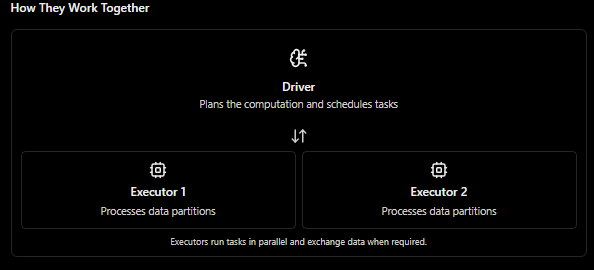

For example, with `df.groupBy("customer").count()`, Spark can process different partitions across multiple executors. Because grouping may require records with the same customer key to be brought together, Spark may perform a shuffle to redistribute data across the cluster.

Key takeaway: The Driver decides how the work should be done, while the Executors perform the distributed data processing.

---

## Each Executor Has Its Own Resources

Spark executors are independent processes, each with its own allocated memory and CPU cores. They do not automatically share their memory with other executors.

### 1. The misconception: One shared memory pool

Imagine you have two executors, each with 8 GB of memory.

- Executor 1: 8 GB
- Executor 2: 8 GB
- Total: 16 GB

You might think Spark provides a shared 16 GB memory pool that either executor can use whenever it needs more memory.

That is not how it works. Each executor has its own memory allocation.

### 2. The reality: Two independent processes

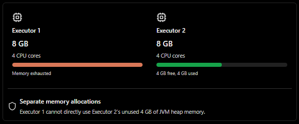

Each executor typically runs in its own Java Virtual Machine (JVM), with its own heap and other memory allocations.

If Executor 1 runs out of usable memory while Executor 2 still has free memory, Executor 1 cannot simply borrow that memory. It may experience garbage-collection pressure, spill data to disk, or fail with an out-of-memory error, depending on the situation.

Important distinction: Although executors have separate memory allocations, they may run on the same physical machine. Their resources are isolated logically, not necessarily physically.

### 3. The consequence: Memory must be managed per executor

Spark distributes tasks across executors, but each executor must handle its own workload with its available resources.

This is why data skew can be a problem. If one executor receives much more demanding work than the others, it may run out of memory even while other executors have resources available.

## Partition → Task → Core → Executor

A partition is a logical chunk of a dataset. A task is the unit of work Spark schedules to process a partition for a particular stage. A CPU core provides processing capacity, and an executor runs the tasks.

Consider this example:

- Dataset: 100 GB
- Number of partitions: 100
- Average partition size: approximately 1 GB
- Executor: 4 available task slots, typically corresponding to 4 CPU cores

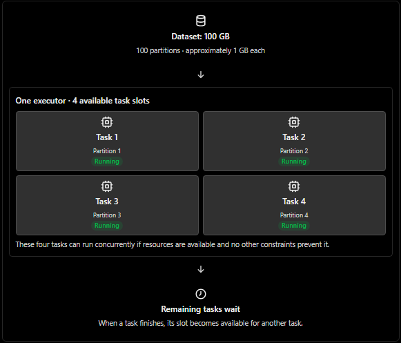

### How CPU cores determine parallelism

With four available task slots, an executor can generally run up to four CPU tasks simultaneously.

- 4 cores / task slots: Up to 4 tasks running concurrently.
- 100 tasks: If all require one task slot, some run first while the rest wait.
- When a task finishes: Another task can use the freed slot.

This is the executor's task parallelism. The actual concurrency can vary because of resource settings, task types, and other constraints.

### What about memory shared by tasks?

Tasks running within the same executor use resources from that executor. They share the executor's overall resource budget, but they do not necessarily share every byte of memory as one common workspace.

For example, if four tasks run inside an executor with 8 GB of JVM heap, they compete for available resources and may each create their own data structures. Spark also uses memory for execution, caching, and other internal operations.

If those tasks collectively demand too much memory, the executor may experience memory pressure or spill intermediate data to disk.

### Key takeaways

- Partitions divide the dataset into logical chunks.
- Tasks process partitions for a particular stage.
- Cores and task slots determine how many tasks can run concurrently.
- Executors run tasks and manage their own allocated resources.
- Memory is allocated per executor, not pooled automatically across the cluster.

---

## 4 Tasks Running, One Shared Execution Memory Pool

Within a single Spark executor, tasks can share the executor's execution memory pool. Memory is not permanently divided into equal-sized chunks for each task; the amount available to a task depends partly on how many other tasks are running and using memory.

### 1. Four active tasks: Each task has a 25% upper limit

When four tasks are active in the same executor, $(N = 4)$.

- Maximum share per task: $(1/N = 1/4 = 25\%)$.
- Guaranteed minimum share before other tasks' usage can restrict it: $(1/(2N) = 1/8 = 12.5\%)$.

If Task B reaches its current upper limit, it may need to spill data to disk rather than acquire more execution memory, even if some memory remains unused in the pool.

### 2. Two tasks remain: The limit increases to 50%

Tasks C and D finish, leaving Tasks A and B active. Now $(N = 2)$.

- Maximum share per task: $(1/2 = 50\%)$.
- Guaranteed minimum share: $(1/(2 \times 2) = 25%)$.

Task B can now acquire more execution memory because its permitted share has increased. It may avoid spilling additional data if enough memory becomes available.

### 3. Only Task B remains: It can use the entire pool

When Task A finishes, Task B is the only active task using this execution memory pool. Now (N = 1).

- Maximum share: $(1/1 = 100\%)$.
- Guaranteed minimum share: $(1/(2 \times 1) = 50\%)$.

Task B can potentially use the entire available execution memory pool, provided that memory is available and no other constraints prevent it.

## How the limits change

Example: an executor has 8 GB of execution memory available for tasks.

Active tasks (N)

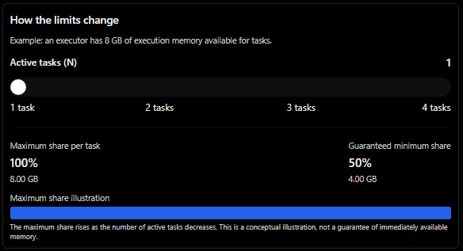
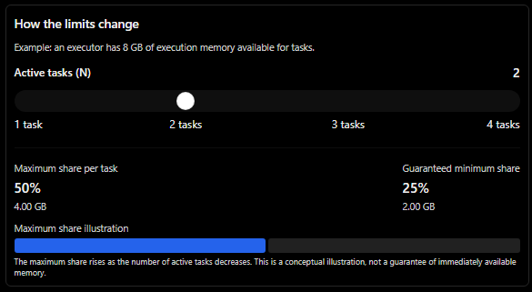
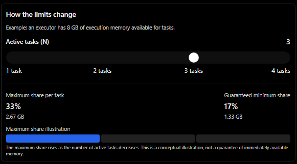
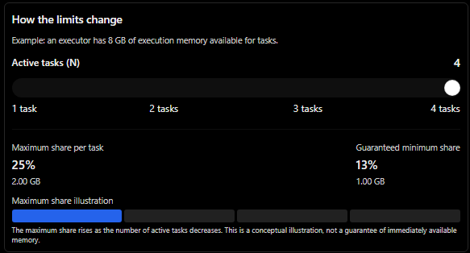

## The two formulas

For $(N)$ active tasks sharing the relevant execution memory pool:

- Upper limit: $(1/N)$ — the maximum fraction of the pool a task can acquire under Spark's shared execution-memory fairness rules.
- Lower bound: $(1/(2N))$ — the threshold used in Spark's fairness mechanism to determine when a task may acquire additional memory despite competing tasks' usage. Below this threshold, a task can generally acquire memory even when the pool is heavily used; beyond it, other tasks' usage can restrict further acquisition.

These are not fixed per-task memory allocations. The actual memory a task obtains depends on pool availability, other tasks' usage, and Spark's execution-memory management.

Key takeaway: A task does not have a permanent memory allowance such as 2 GB. As other tasks finish, the remaining tasks may acquire a larger share of the executor's execution memory, potentially reducing the need to spill data to disk.

---

## How Does Spark Organize Its 8 GB of Memory?

An executor's memory is not one large pool that every task can freely use. Spark divides its memory into regions, each serving a different purpose.

The exact layout depends on the executor's JVM heap size and Spark configuration. Using an 8 GB heap as a simplified example:

### 1. Understanding the memory regions

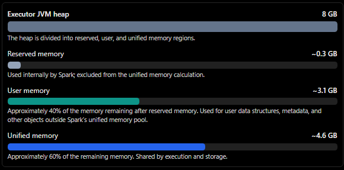

Spark's default memory calculation is approximately:

$M=(H-R)\times 0.6$

Where:

- $(H)$ = JVM heap size.
- $(R)$ = reserved memory, approximately 300 MiB by default.
- $(M)$ = unified memory available for execution and storage.

For an 8 GiB heap:

$M\approx(8-0.293)\times0.6 \approx4.62\text{ GiB}$

The remaining memory is approximately 3.09 GiB for user memory, plus the reserved portion.

Important: These are approximate values based on Spark's standard memory model, not a guarantee that exactly 4.62 GiB is available for active tasks at every moment. JVM overhead, off-heap allocations, and executor container limits also matter.

### 2. Unified memory: Execution vs. Storage

The unified memory region is where Spark manages two important categories:

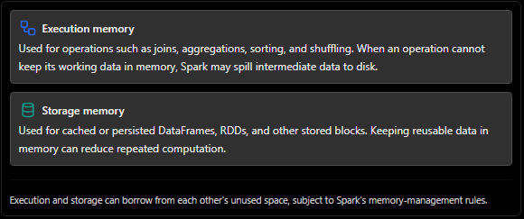

### 3. What does the 0.5 storage floor mean?

Spark's default `spark.memory.storageFraction` is `0.5`.

This means approximately half of the unified memory region is the protected storage region under the standard memory model.

For a 4.62 GiB unified memory region:

$4.62\times0.5\approx2.31\text{ GiB}$

This does not mean storage always occupies 2.31 GiB, or that execution can never use that memory. It is a threshold that affects how execution can reclaim storage memory: execution can evict storage blocks that occupy memory beyond the protected region, but it cannot force storage to surrender blocks within that protected region.

Conversely, storage can use available unified memory that execution is not currently using.

Key takeaway: Execution and storage share the unified memory pool, but their interaction is governed by eviction and allocation rules. Spilling occurs when an execution operation cannot obtain enough memory to continue in memory; it does not automatically occur just because the unified pool reaches a particular percentage.

## Storage Memory: “I Want to Keep This Result”

When you call `cache()` on a DataFrame, you tell Spark that you want to reuse its computed result rather than repeatedly recomputing it.

Consider this example:

```python
filtered = customers.filter("age > 25")filtered.cache()  # Step 1filtered.count()  # Action 1filtered.groupBy("city").count()  # Action 2
```

### Step 1: Define the cache

```python
filtered.cache()
```

Nothing is computed immediately. Spark marks `filtered` for caching, using the default persistence level for DataFrames, `MEMORY_AND_DISK_DESER`.

This means Spark can keep cached partitions in memory and store them on disk when necessary.

### Step 2: The first action

```python
filtered.count()
```

`count()` is an action, so Spark executes the computation needed to produce the result.

Spark reads the required source data, applies the filter, and attempts to cache the resulting partitions as they are computed.

The first action must still perform the read and filter because the cached result does not exist yet.

### Step 3: The second action

```python
filtered.groupBy("city").count()
```

Spark can reuse the cached partitions of `filtered` instead of repeating the source read and filter for those partitions that remain available in the cache.

It still needs to perform the grouping and counting operations. Caching `filtered` does not cache the result of every downstream query automatically.

Also, cached partitions may be missing or evicted from memory. If a required partition is unavailable, Spark may recompute it from its lineage or retrieve it from disk, depending on the persistence behavior.

### Step 4: What happens without `cache()`?

Without `filtered.cache()`, each action can independently execute the operations needed to produce `filtered`.

For example:

- `filtered.count()` reads the necessary input and applies the filter.
- `filtered.groupBy("city").count()` may read the input and apply the filter again before grouping.

For large datasets or expensive transformations, repeating these operations can be costly.

### Workflow comparison

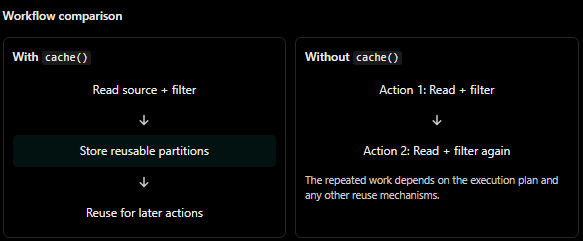

The repeated work depends on the execution plan and any other reuse mechanisms.

Key takeaway: `cache()` marks a DataFrame for reuse; an action triggers computation and populates the cache. Subsequent actions can reuse cached partitions, saving computation time when the same intermediate data is needed repeatedly.

---

## What Does “Caching” Really Mean?

Caching in Spark means saving the results of previously computed partitions so they can be reused without repeating the same transformations.

It is not a separate, magical memory area. Cached data occupies resources managed by Spark on the executors.

### 1. Spark caches partitions, not one giant DataFrame

A DataFrame is distributed across partitions, and those partitions can be processed by different executors.

When you cache a DataFrame, Spark stores its computed partitions individually. Each partition is cached where it is materialized, rather than collecting the entire DataFrame onto one machine.

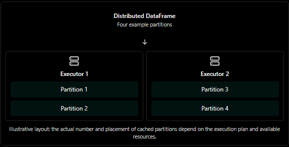

### 2. Where is cached data stored?

For PySpark DataFrames, `cache()` uses the default persistence level `MEMORY_AND_DISK_DESER`.

This means Spark attempts to keep cached partitions in memory and can store partitions that do not fit in memory on disk.

You can also choose different persistence levels with `persist()`.

Cached data is distributed across executors, and its memory usage is managed through Spark's storage mechanisms. The memory available for caching interacts with the memory used for computation.

Key takeaway: Caching saves computed data for reuse; it does not create a separate memory pool or guarantee that every partition stays in RAM.

## Execution Memory: “I Need Memory to Work”

While storage memory keeps previously computed data, execution memory provides working space for computations currently in progress.

Operations such as grouping, sorting, and joining may need temporary data structures to process records efficiently.

### 1. `df.groupBy("city").count()`

Spark groups records by city and calculates the number of records in each group.

A common implementation uses a hash-based aggregation structure:

- Spark reads records from its input partitions.
- It uses each city's key to find the corresponding aggregation entry.
- It updates the count for that city.
- It produces the aggregated results.

The aggregation structure uses execution memory. If it grows too large, Spark may spill intermediate data to disk.

### 2. `df.orderBy("age")`

Sorting arranges records according to the specified column.

Spark may use in-memory sorting structures and external sorting algorithms:

- Records are collected into working buffers.
- Spark sorts data in memory where possible.
- If the data exceeds available memory, Spark can sort chunks and spill sorted data to disk.
- The sorted results are combined as required by the execution plan.

Correction: Sorting does not always require all records to fit in memory simultaneously. Spark supports external sorting precisely because datasets can be larger than available memory.

### 3. `df.join(other_df, "id")`

A join combines records from two DataFrames based on matching `id` values.

The execution strategy determines which data structures Spark uses:

- Broadcast hash join: Spark sends a sufficiently small side of the join to other executors, where it can be held in a hash table.
- Sort-merge join: Spark sorts the relevant data by join key and merges matching records. This can involve sorting and spilling.
- Shuffled hash join: Spark redistributes data by key and builds hash tables for one side of each partition-level join.

Not every join loads one entire DataFrame into memory. The algorithm depends on the execution plan, data size, partitioning, and configuration.

## Storage Memory vs. Execution Memory

Both are managed within Spark's unified memory system, but they serve different purposes.

| Concept                     | Storage memory                                                                         | Execution memory                                                |
| --------------------------- | -------------------------------------------------------------------------------------- | --------------------------------------------------------------- |
| Purpose                     | Keep computed data for reuse                                                           | Provide working space for computations                          |
| Common APIs or operations   | `df.cache()`, `df.persist()`                                                           | `groupBy()`, `orderBy()`, `join()`                              |
| Typical contents            | Cached or persisted data partitions                                                    | Aggregation structures, sorting buffers, join hash tables       |
| Lifespan                    | While cached blocks remain persisted                                                   | While computation requires the working data                     |
| When memory is insufficient | Blocks may be evicted from memory or stored on disk, depending on persistence settings | Intermediate data may spill to disk, depending on the operation |

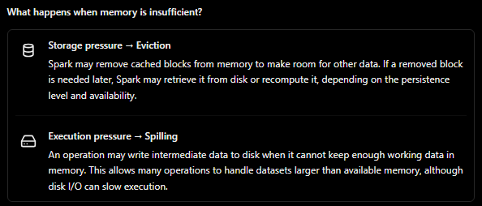

Key takeaway: Storage memory keeps useful results; execution memory helps Spark calculate new results. They have different purposes, but they interact within the executor's memory-management system.

---

