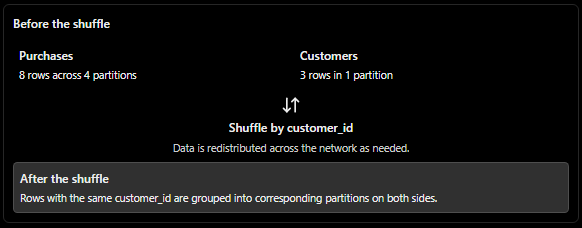
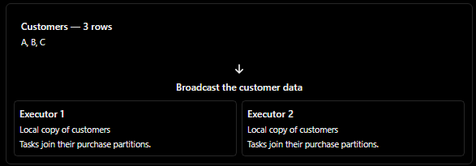
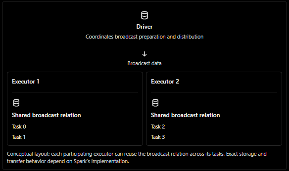
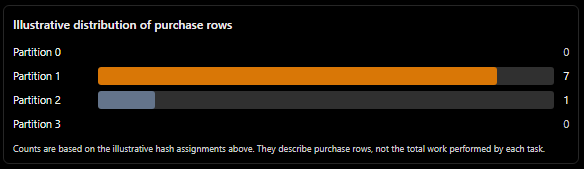
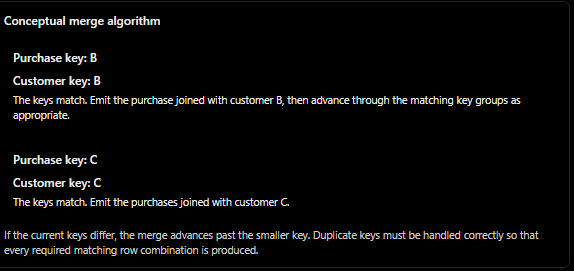

# Joins: Under the Hood

A Spark join combines rows from two tables based on a shared column, such as `customer_id`.

To understand how Spark performs a join, we need to know:

- What data moves: How much information Spark sends between machines.
- What data is stored: Whether Spark keeps data in memory or writes it to disk.
- Where data is stored: Which machine or partition holds each row.
- What each task calculates: What work each Spark task performs.
- Why performance varies: Why some join strategies are faster or slower depending on the data and cluster.

## Example: Two small tables

Suppose we have two tables.

`purchases` — 8 rows

| purchase_id | customer_id | value |
| ----------- | ----------- | ----- |
| 1           | C           | 100   |
| 2           | C           | 250   |
| 3           | A           | 80    |
| 4           | C           | 40    |
| 5           | B           | 300   |
| 6           | C           | 75    |
| 7           | C           | 120   |
| 8           | A           | 60    |

`customers` — 3 rows

| customer_id | name        | city     |
| ----------- | ----------- | -------- |
| A           | Bender      | Bogota   |
| B           | RickC137    | Cali     |
| C           | Darth Vader | Medellin |

We join the tables using `customer_id`:

```python
purchases.join(customers, "customer_id")
```

Because no join type is specified, Spark performs an inner join by default. It keeps only rows with matching `customer_id` values in both tables.

### Expected result

| purchase_id | customer_id | value | name        | city     |
| ----------- | ----------- | ----- | ----------- | -------- |
| 1           | C           | 100   | Darth Vader | Medellin |
| 2           | C           | 250   | Darth Vader | Medellin |
| 3           | A           | 80    | Bender      | Bogota   |
| 4           | C           | 40    | Darth Vader | Medellin |
| 5           | B           | 300   | RickC137    | Cali     |
| 6           | C           | 75    | Darth Vader | Medellin |
| 7           | C           | 120   | Darth Vader | Medellin |
| 8           | A           | 60    | Bender      | Bogota   |

The result contains 8 rows because every purchase has a matching customer. The customer information is repeated whenever that customer has multiple purchases.

### Why this example matters

Customer C appears in 6 of the 8 purchases. This uneven distribution illustrates data skew: some join keys occur much more frequently than others.

In a real production environment, millions of purchases might belong to the same customer or a small group of customers. That imbalance can cause certain Spark tasks to process much more data than others, slowing down the entire job.

### The key principle

The join's logical result is determined by the input data and the join condition, not by the execution strategy.

Spark can use different physical strategies to produce the same logical result. What changes is how much data must move across the network, how much intermediate data is stored in memory or on disk, how work is distributed across tasks, and how long the join takes.

---

## What Happens in Spark?

### 1. Data is divided into partitions

In Apache Spark, a table is distributed across partitions, which are logical chunks of data processed in parallel. A partition is not necessarily stored on a single machine permanently; Spark schedules tasks to process partitions, and the data may be read from files or held in memory across different executors.

For this example, assume the data is divided as follows.

`purchases` — 4 partitions

| Partition | Data                           |
| --------- | ------------------------------ |
| 0         | Purchase 1 (C), Purchase 2 (C) |
| 1         | Purchase 3 (A), Purchase 4 (C) |
| 2         | Purchase 5 (B), Purchase 6 (C) |
| 3         | Purchase 7 (C), Purchase 8 (A) |

`customers` — 1 partition

| Partition | Data                               |
| --------- | ---------------------------------- |
| 0         | Customer A, Customer B, Customer C |

This is a simplified example. In practice, partitioning depends on factors such as the input files, file sizes, source configuration, and operations such as `repartition()`.

### 2. Spark creates tasks to process partitions

Spark can process the four `purchases` partitions using four separate tasks.

| Task   | Partition processed | Purchases      |
| ------ | ------------------- | -------------- |
| Task 0 | Partition 0         | Purchases 1, 2 |
| Task 1 | Partition 1         | Purchases 3, 4 |
| Task 2 | Partition 2         | Purchases 5, 6 |
| Task 3 | Partition 3         | Purchases 7, 8 |

Each task processes its assigned partition. However, a task is not permanently tied to a specific machine, and it can access data beyond its input partition when Spark's execution strategy makes that data available.

### 3. The join problem: Where is the customer information?

Imagine Task 1 processes these two purchases:

| purchase_id | customer_id | value |
| ----------- | ----------- | ----- |
| 3           | A           | 80    |
| 4           | C           | 40    |

To complete the join, Task 1 needs the corresponding customer information:

| customer_id | name        | city     |
| ----------- | ----------- | -------- |
| A           | Bender      | Bogota   |
| C           | Darth Vader | Medellin |

But Task 1's `purchases` partition contains neither customer names nor cities.

Can Task 1 access that information?

Yes, but it depends on the physical join strategy Spark chooses.

- Broadcast hash join: Spark can send a copy of the small `customers` table to the executors processing `purchases`. Task 1 can then look up customers A and C locally.
- Sort-merge join: Spark typically redistributes both tables by `customer_id`, sorts the relevant data, and joins matching keys. Task 1 may need to receive data from other partitions before performing the join.
- Shuffled hash join: Spark redistributes data by join key and builds a hash table for one side of each partition-level join.

The key distinction is that Spark does not automatically make every table available inside every task. The execution strategy determines how the required data becomes accessible.

That is why choosing the right join strategy matters: it determines how much data Spark moves across the network, how much memory it needs, and how much work each task must perform.

---

## The Distributed Join Problem

A distributed join becomes challenging when the two tables are stored in different partitions or processed by different executors. Spark must make matching rows available to the same task before it can combine them.

### Starting point

Assume `purchases` is divided into four partitions across two executors, while `customers` is stored separately and initially processed by another task.

- `purchases` contains eight purchase records.
- `customers` contains three customer records.
- Both tables share the `customer_id` column, which Spark uses to match rows.

### 1. One task, one partition

Each Spark task processes an assigned partition. For this example, Task 1 processes Partition 1 of `purchases`:

| purchase_id | customer_id | value |
| ----------- | ----------- | ----- |
| 3           | A           | 80    |
| 4           | C           | 40    |

Task 1 has access to these purchase records, but the customer names and cities are not included in this partition.

A task can access data beyond its assigned partition when Spark's execution strategy makes that data available. However, the required customer records are not automatically available just because another task has read them.

### 2. What is needed?

To complete the join, Task 1 needs the corresponding rows from `customers`:

| customer_id | name        | city     |
| ----------- | ----------- | -------- |
| A           | Bender      | Bogota   |
| C           | Darth Vader | Medellin |

The task needs to match each purchase with the customer having the same `customer_id`.

### 3. The problem: Data is not automatically accessible

The customer records may reside in another partition, executor, or machine. Task 1 cannot simply assume that those records are available in its local memory.

Spark must arrange for the necessary data to become accessible. Depending on the join strategy, it can redistribute both tables or distribute a copy of the smaller table.

This is the fundamental challenge of a distributed join: matching records must be brought together logically, even when they start in different locations.

### 4. The rule: Matching records must meet

For a conventional equality join, Spark needs a way to bring matching keys together or make one side of the join locally available.

There are two common approaches:

- Shuffle both tables: Redistribute the data so rows with the same join key reach the same partition.
- Broadcast the smaller table: Copy the smaller table to the executors that need it, allowing them to join it with their local partitions.

These approaches solve the same problem but have different network, memory, and processing costs.

## Two Ways to Perform a Distributed Join

### Starting point

The initial layout is:

- `purchases`: 8 rows distributed across 4 partitions.
- `customers`: 3 rows in one partition.

The following strategies can produce the same logical join result.

### 1. Moving both tables: Shuffle join

Spark redistributes both tables according to `customer_id`. This process is called a shuffle.

With four target partitions, Spark applies a consistent partitioning rule to both tables. Rows with the same key are assigned to the same target partition.

For example, every purchase with `customer_id = C` and the customer record for C will be routed to the same partition. The task processing that partition can then match them.

 

A shuffle can involve network transfers, intermediate data written to local disk, serialization, and additional memory use. The exact amount of data transferred depends on the partitioning, existing data placement, and execution details.

In this simplified scenario, assume 11 rows are transferred over the network. This is an illustrative count, not a general Spark rule: actual shuffle traffic is measured in bytes and depends on the data and execution plan.

### 2. Copying the smaller table: Broadcast join

Because `customers` contains only three rows, Spark may choose to broadcast it.

A broadcast join sends a copy of the small table to the participating executors. Tasks processing partitions of `purchases` can then look up the corresponding customer records locally.



In this strategy, the original purchase records do not need to be shuffled just to match customer information. However, the customer data must still be transmitted to participating executors, and storing its copy consumes memory.

Spark generally uses a broadcast hash join for this type of operation: each task can use a local hash table built from the broadcast customer data to find matching keys efficiently.

### 3. Same result, different costs

Both strategies produce the same logical join result: eight rows in this example.

| Factor                 | Shuffle join                                       | Broadcast join                                                   |
| ---------------------- | -------------------------------------------------- | ---------------------------------------------------------------- |
| Network traffic        | Redistributes data from both sides as needed       | Distributes the smaller table to participating executors         |
| Purchase data movement | May require redistribution                         | Typically avoids shuffling the purchase table                    |
| Memory usage           | Depends on shuffle buffers and join implementation | Requires memory for the broadcast data and local join structures |
| Disk I/O               | May write shuffle data to disk                     | Avoids the join shuffle, though other disk I/O may occur         |
| Best suited for        | Large datasets when redistribution is appropriate  | One side is small enough to broadcast efficiently                |

### 4. Why does Spark sometimes choose the slower method?

The fastest strategy depends on the actual data size, the cluster, and the physical execution plan.

A broadcast join is often faster when one table is small because it avoids shuffling the larger table. However, broadcasting a large table can consume too much memory, increase network traffic, and cause executor failures.

A shuffle join can be more appropriate when both tables are large. It has redistribution costs, but those costs may be preferable to replicating a large table across the cluster.

Spark's choice can also be affected by:

- Table size estimates and available statistics.
- The broadcast threshold and other configuration settings.
- Existing partitioning and the physical query plan.
- Adaptive Query Execution (AQE), which can revise certain execution decisions using runtime statistics.

The central idea: Spark chooses how to make matching data available to join tasks. Understanding the amount of data moved, the memory required, and the distribution of work helps explain why one join strategy performs better than another.

---

## What You Request vs. What Spark Executes

In Spark, a join has two distinct aspects: the logical join type and the physical join strategy.

- Logical join type: Defines which rows should appear in the result.
- Physical join strategy: Defines how Spark processes the data to produce that result.

The logical type determines what the result means. The physical strategy determines how Spark computes it.

## 1. Logical Join Type

The logical join type specifies which rows to include based on whether matching records exist in the other table.

In PySpark, you can specify it using the `how` parameter:

```python
purchases.join(customers, on="customer_id", how="inner")
```

Common join types include:

| Join type | Rows included                                                                                    |
| --------- | ------------------------------------------------------------------------------------------------ |
| `inner`   | Rows with matching keys in both tables.                                                          |
| `left`    | All rows from the left table, including unmatched rows with nulls for missing right-side values. |
| `right`   | All rows from the right table, including unmatched rows with nulls for missing left-side values. |
| `full`    | All rows from both tables, matching where possible and filling missing values with nulls.        |
| `semi`    | Left-side rows that have at least one match on the right.                                        |
| `anti`    | Left-side rows that have no match on the right.                                                  |

The join type defines the required result, but it does not specify whether Spark should shuffle the data, broadcast a table, sort the rows, or build a hash table.

## 2. Physical Join Strategy

The physical join strategy determines how Spark executes the join. It affects data movement, memory consumption, disk I/O, and execution time.

Spark has several physical join strategies. Five important ones are described below.

### 1. Broadcast Hash Join

Often fastest for a small table

Spark broadcasts the smaller table to the participating executors and builds a hash table from it. Tasks can then look up matching keys locally while processing the other table.

When it is useful: One side is small enough to broadcast efficiently, and the join type and condition support this strategy.

In the physical plan: `BroadcastHashJoin`, often accompanied by `BroadcastExchange` and a build-side indicator such as `BuildRight`.

Equality-based: Yes, for ordinary broadcast hash joins.

Main advantage: Avoids shuffling the larger table, reducing network traffic and often improving performance.

Important detail: Spark's default automatic broadcast threshold is commonly 10 MB, but the actual value depends on configuration and can be overridden by hints. Being smaller than 10 MB does not guarantee that Spark will choose this strategy. It must also be supported by the join type and condition.

### 2. Sort-Merge Join

Spark redistributes both tables by the join key, sorts the resulting partitions, and merges matching rows by traversing the sorted data.

When it is useful: Both tables are large and have compatible equality-based join conditions.

In the physical plan: `SortMergeJoin`, often with two `Exchange` operations and `Sort` operations.

Equality-based: Yes, for ordinary sort-merge joins.

Main advantage: Handles large datasets effectively without requiring the entire join input to fit in memory. Sorting can spill intermediate data to disk when memory is insufficient.

Main cost: Shuffling and sorting can generate substantial network and disk I/O.

Sort-merge join is a common default for large equi-joins, but it is not guaranteed to be Spark's default for every join. The chosen strategy depends on the plan, statistics, hints, configuration, and runtime optimizations.

### 3. Shuffled Hash Join

Spark redistributes both tables by the join key. Each task builds a hash table from one side of its shuffled partition and probes it using rows from the other side.

Unlike sort-merge join, it does not need to sort both inputs.

When it is useful: The join keys support equality matching, and the build-side partition is small enough to fit comfortably in memory.

In the physical plan: `ShuffledHashJoin`, usually with shuffle `Exchange` operations but without the sorting required by sort-merge join.

Equality-based: Yes, for ordinary shuffled hash joins.

Main advantage: Can avoid sorting and perform well when the build-side partitions are sufficiently small.

Main risk: A large build-side partition can consume too much memory and cause excessive garbage collection or executor failure.

A `hint("shuffle_hash")` can encourage Spark to choose this strategy, but it does not guarantee that Spark will use it in every situation. Spark can also select shuffled hash joins without an explicit hint when the configuration and planning conditions permit them.

### 4. Broadcast Nested Loop Join

Spark broadcasts one side of the join and compares its rows against rows from the other side. Unlike a hash join, it does not need a hash lookup on an equality key.

When it is useful: The join condition is non-equality-based, such as a range or inequality condition, and broadcasting one side is practical. It can also appear as a fallback for certain other join conditions or join types.

In the physical plan: `BroadcastNestedLoopJoin`.

Equality-based: No equality key is required, although the join condition can contain additional predicates.

Main advantage: Supports join conditions that cannot use ordinary hash-based or sort-merge strategies.

Main cost: May require comparing a large number of row pairs. With $(m)$ rows on one side and $(n)$ rows on the other, the worst-case comparison work can approach $(m \times n)$.

### 5. Cartesian Product

A Cartesian product pairs every row from one table with every row from the other table.

For example, joining a table with 8 rows to a table with 3 rows produces $(8 \times 3 = 24)$ row pairs.

When it is useful: You explicitly request a cross join or the query plan requires a Cartesian product for a supported operation.

In the physical plan: `CartesianProduct` for Spark's Cartesian-product execution operator.

Equality-based: No join key is required.

Main cost: The output grows multiplicatively with the sizes of the input tables, which can make this operation extremely expensive.

A Cartesian product is not simply another name for every non-equi join. Spark may use a broadcast nested loop join for a non-equality condition, and a Cartesian product generally represents an operation that generates all possible row pairs.

## 3. Comparison at a Glance

| Strategy              | Redistributes data?           | Sorts inputs? | Builds a hash table? | Typical use                                         |
| --------------------- | ----------------------------- | ------------- | -------------------- | --------------------------------------------------- |
| Broadcast hash join   | Broadcasts one side           | No            | Yes                  | One side is small                                   |
| Sort-merge join       | Usually shuffles both sides   | Yes           | No                   | Large equality joins                                |
| Shuffled hash join    | Usually shuffles both sides   | No            | Yes                  | Build-side partitions are small                     |
| Broadcast nested loop | Broadcasts one side           | No            | No                   | Non-equality conditions or supported fallback cases |
| Cartesian product     | Depends on the execution plan | No            | No                   | All possible row pairs                              |

## 4. How to Inspect the Strategy Spark Chooses

Use `explain()` to inspect the physical execution plan:

```python
purchases.join(
        customers,
        on="customer_id",
        how="inner"
    ).explain("formatted")
```

Look for operators such as `BroadcastHashJoin`, `SortMergeJoin`, `ShuffledHashJoin`, `BroadcastNestedLoopJoin`, and `CartesianProduct`.

The plan can also reveal exchanges, sorts, and which side Spark builds its hash table from.

Key takeaway: The logical join type determines which rows belong in the result. The physical join strategy determines how Spark makes the necessary data available and performs the computation. Choosing an efficient strategy can dramatically reduce network traffic, memory pressure, and execution time.

---

## Strategy 1: Broadcast Hash Join

### Where Does the Copy of the `customers` Table Actually Live?

A broadcast hash join allows Spark to distribute a small table to the executors so that tasks can look up matching rows locally, without shuffling the larger table.

The important question is: Where is the broadcast copy stored, and who can access it?

The answer involves the driver, the executors, and the tasks running on those executors.

### 1. The driver prepares the broadcast data

Spark first executes the work needed to collect the small `customers` table for broadcasting. The exact execution plan can vary, but the driver coordinates the operation and prepares the broadcast representation.

For a broadcast hash join, Spark builds a hashed representation of the smaller table so that matching rows can be found efficiently using `customer_id`.

For example:

| Key | Customer information  |
| --- | --------------------- |
| A   | Bender, Bogota        |
| B   | RickC137, Cali        |
| C   | Darth Vader, Medellin |

Conceptually, this hash table allows Spark to look up a customer by key instead of scanning all three customer records for every purchase.

Important distinction: Spark does not necessarily collect the table as an ordinary DataFrame on the driver and then manually build the final join hash table there. The broadcast preparation and hash-relation construction are implementation details of Spark's execution process.

### 2. The driver distributes the broadcast data

Spark serializes the broadcast data into blocks that can be transferred to executors.

In a log, you might see a block name such as `broadcast_9_piece0` and a size such as `206.0 B`.

This represents a serialized broadcast block, not necessarily the size of the final in-memory hash table. Serialization, metadata, and the hash-table representation can have different memory footprints.

The driver coordinates the broadcast process, while Spark's broadcast mechanism manages the distribution of the data.

### 3. Each executor obtains the broadcast data

When an executor needs the broadcast relation, Spark makes the broadcast data available to it. The executor can reuse that data across tasks running in the same executor.

Conceptually, the structure looks like this:

 

Conceptual layout: each participating executor can reuse the broadcast relation across its tasks. Exact storage and transfer behavior depend on Spark's implementation.

The broadcast relation is not a partition of the original `customers` DataFrame, and it is not owned exclusively by one task.

It is a shared, read-only data structure that tasks can access while executing the join.

Is it stored in memory or on disk?

- The deserialized hash relation used for lookups is normally held in executor memory.
- Serialized broadcast blocks may be stored and retrieved through Spark's block-management and broadcast mechanisms.
- Disk use depends on the implementation, storage configuration, and memory pressure. A broadcast join does not mean that every representation exists exclusively in memory at all times.

The phrase Storage Memory should therefore be interpreted carefully: broadcast blocks and execution-time hash structures have specific storage behaviors, and they are not necessarily identical to a user-cached DataFrame.

### 4. Each task performs local lookups

Once the broadcast relation is available, each task processes its assigned partition of `purchases`.

For example, Task 1 processes:

| purchase_id | customer_id | value |
| ----------- | ----------- | ----- |
| 3           | A           | 80    |
| 4           | C           | 40    |

It looks up customer A and customer C in the local broadcast hash relation and produces:

| purchase_id | customer_id | value | name        | city     |
| ----------- | ----------- | ----- | ----------- | -------- |
| 3           | A           | 80    | Bender      | Bogota   |
| 4           | C           | 40    | Darth Vader | Medellin |

The original purchase rows do not need to be shuffled merely to match customer information.

Because purchases remain in their original partitions, the six purchases belonging to customer C remain distributed across the four partitions in this example.

This avoids introducing additional key-based redistribution for the join. However, broadcasting does not guarantee that all other forms of skew or uneven task duration disappear.

## Broadcast Hash Join: When and Why?

Broadcast hash join is often one of the fastest strategies when one table is small enough to broadcast and the join operation supports this strategy.

### Why can it be fast?

- No large-table shuffle: Spark avoids redistributing the larger table just to match join keys.
- No required sort: Hash lookups replace the sorting required by sort-merge join.
- Parallel processing: Tasks continue processing their assigned partitions of the larger table.
- Local lookups: Each task uses the broadcast hash relation to find matching rows efficiently.

These advantages can significantly reduce network traffic and execution time.

### When does Spark use it?

Spark may select a broadcast hash join when the estimated size of one side is below `spark.sql.autoBroadcastJoinThreshold`, which is commonly set to 10 MB by default.

You can also encourage broadcasting explicitly.

PySpark:

```python
from pyspark.sql.functions import broadcast

purchases.join(
    broadcast(customers),
    on="customer_id",
    how="inner")
```

Or use a SQL hint:

```sql
SELECT /*+ BROADCAST(c) */
    p.purchase_id,
    p.customer_id,
    p.value,
    c.name,
    c.city
FROM purchases p
JOIN customers c
    ON p.customer_id = c.customer_id
```

A broadcast hint encourages Spark to use a broadcast strategy even when the estimated table size exceeds the automatic threshold. However, the join type and condition must still support the chosen physical strategy, and broadcasting a large table can cause memory problems.

## Limit 1: Memory and Distribution Costs

The broadcast relation must be made available to the participating executors, and its in-memory representation can consume substantial memory.

For example, a table with a small serialized size may require significantly more memory after being deserialized and converted into a hash structure.

Broadcasting a very large table can cause:

- High memory consumption across executors.
- Additional network traffic to distribute the table.
- Increased garbage collection.
- Executor failures or out-of-memory errors.

This is why broadcasting tables that occupy gigabytes of memory is generally impractical, even if a hint can encourage Spark to attempt it.

## Limit 2: The Join Type and Which Side Must Be Preserved

Not every logical join type supports a broadcast hash join with either table as the build side.

For an ordinary equi-join, the relevant distinction is whether the build side can be broadcast while preserving the required rows from the other side.

| Logical join                    | Can broadcast hash join be used?                                                                    | Explanation                                                                      |
| ------------------------------- | --------------------------------------------------------------------------------------------------- | -------------------------------------------------------------------------------- |
| `purchases LEFT JOIN customers` | Yes, typically with `customers` as the build side                                                   | All purchases must be preserved, including purchases without matching customers. |
| `customers LEFT JOIN purchases` | Yes, typically with `purchases` as the build side if the physical strategy and conditions permit it | All customers must be preserved, including customers without purchases.          |
| `FULL OUTER JOIN`               | No, not with the ordinary broadcast hash join strategy                                              | Both sides must be preserved, including unmatched rows from either side.         |

The reason is not simply that a task cannot determine whether customer D has a matching purchase. Spark has strategies for tracking unmatched rows. Rather, the ordinary broadcast hash join implementation does not support full outer joins because it must preserve unmatched rows from both inputs.

For a full outer join, Spark may instead use a sort-merge join or another applicable strategy.

### The rule

The join strategy must support the logical join type, and the chosen build side must be compatible with the rows that the join must preserve.

When broadcast hash join is not applicable or is not selected, Spark evaluates other physical strategies, such as sort-merge join or shuffled hash join, depending on the query, configuration, and available statistics.

---

## Strategy 2: Sort-Merge Join

A Sort-Merge Join is a common Spark strategy for joining large tables when both sides cannot be efficiently broadcast. Spark redistributes both tables by the join key, sorts the data within each partition, and then merges matching rows.

The main costs are the shuffle, sorting, and potentially spilling intermediate data to disk.

### 1. The starting point: Neither table is suitable for broadcasting

Suppose both tables are large enough that broadcasting either one would be impractical.

Spark can use a sort-merge join to distribute the data across the cluster and match rows with the same `customer_id`.

The process has three main phases:

1. Shuffle: Redistribute rows according to the join key.
2. Sort: Sort the rows within each resulting partition.
3. Merge: Traverse both sorted inputs and combine rows with matching keys.

### 2. The partitioning formula

Conceptually, Spark assigns each row to a partition based on its join key:

$\text{partition} = \operatorname{pmod}(\operatorname{hash}(\text{customer\_id}), 4)$

Here, `pmod` represents a non-negative modulo operation. This is a simplified illustration of hash partitioning, not the exact implementation of every Spark partitioning expression.

Both tables use compatible partitioning so that rows with the same key are routed to the same partition.

For example, assume the resulting assignments are:

| Customer ID | Target partition |
| ----------- | ---------------- |
| A           | 2                |
| B           | 1                |
| C           | 1                |

These values are illustrative. Spark's actual hash function and partition assignment determine the real destinations; Python's built-in `hash()` should not be used to predict Spark's partition IDs.

### 3. Shuffling the `purchases` table

Spark redistributes purchase records according to their target partition.

Under the illustrative assignments above, the data is distributed as follows:

| Target partition | Purchase records                                |
| ---------------- | ----------------------------------------------- |
| 0                | None                                            |
| 1                | Purchase 5 (B), and purchases 1, 2, 4, 6, 7 (C) |
| 2                | Purchases 3 and 8 (A)                           |
| 3                | None                                            |

Partition 1 receives six purchases for customer C and one purchase for customer B.

During a shuffle, Spark may serialize records, write intermediate shuffle data to local disk, transfer data over the network, and read it into downstream tasks. The exact amount of disk and network I/O depends on the execution plan and whether data can be reused or avoided through existing partitioning.

Why is this expensive?

If a 500 GB purchases table must be fully shuffled, Spark may need to redistribute a substantial portion of those 500 GB, even if the other table contains relatively little data. The shuffle is not automatically eliminated just because one side is smaller.

However, Spark does not necessarily shuffle every byte: existing compatible partitioning, query optimizations, and the physical execution plan can reduce or eliminate some exchanges.

### 4. Shuffling the `customers` table

Spark also redistributes the customer records using the same compatible partitioning rule.

| Target partition | Customer records |
| ---------------- | ---------------- |
| 0                | None             |
| 1                | B, C             |
| 2                | A                |
| 3                | None             |

Now, each non-empty partition contains the customer records and purchases associated with the same customer keys.

For example, Partition 1 contains the purchases for B and C, along with the corresponding customer records for B and C. Its downstream task can perform the join without needing to fetch those matching rows from another partition.

### 5. Data skew: When one task receives much more work

Data skew occurs when data is distributed unevenly across partitions, often because some join keys appear far more frequently than others.

In this example, Partition 1 receives seven of the eight purchase rows. The remaining purchase rows go to Partition 2.

Illustrative distribution of purchase rows

 

If millions of purchases share the same customer ID, the corresponding shuffle partition can become much larger than the others. Its task may take significantly longer to finish, even after the other tasks have completed.

This is join-key skew. It originates in the distribution of key frequencies and becomes a performance problem when partitioning concentrates too much work in a small number of tasks.

A critical distinction: skew is not caused by hashing itself. Hash partitioning distributes different keys among partitions, but every occurrence of the same key must normally go to the same partition for a standard sort-merge join. A highly frequent key can therefore create a large partition.

## 6. Sorting: Preparing the data for the merge

After the shuffle, each task sorts the rows in its partition by `customer_id`.

For Partition 1, the purchase records can be ordered as follows:

| purchase_id | customer_id | value |
| ----------- | ----------- | ----- |
| 5           | B           | 300   |
| 1           | C           | 100   |
| 2           | C           | 250   |
| 4           | C           | 40    |
| 6           | C           | 75    |
| 7           | C           | 120   |

The corresponding customer records are sorted by the same key:

| customer_id | name        | city     |
| ----------- | ----------- | -------- |
| B           | RickC137    | Cali     |
| C           | Darth Vader | Medellin |

Sorting places equal keys together and allows Spark to merge the two inputs efficiently.

### 7. Merging: A two-pointer approach

Imagine two sorted lists:

- The purchase list contains the purchase rows.
- The customer list contains one row per customer.

Spark traverses both lists, comparing their current keys.



The keys match. Emit the purchases joined with customer C.

If the current keys differ, the merge advances past the smaller key. Duplicate keys must be handled correctly so that every required matching row combination is produced.

Because both inputs are sorted, Spark does not need to repeatedly scan the entire customer table for every purchase. It can advance through the ordered inputs rather than moving backward through them.

For a standard equality join, the merge phase is approximately linear in the size of the sorted inputs, plus the work required to produce the output. When keys are duplicated on both sides, all matching combinations must still be generated.

### 8. What happens when sorting exceeds memory?

Spark can use external sorting when the data cannot fit entirely in memory.

Instead of keeping all records in memory, it sorts manageable chunks, writes sorted runs to disk, and merges those runs as needed. This process is called spilling.

Spilling allows Spark to process data sets larger than the available execution memory, although it can substantially increase disk I/O and execution time.

The exact behavior depends on the sorting and execution implementation; spilling does not guarantee that every operation will succeed regardless of resource limits.

### 9. Why skew and spilling together are a warning sign

Suppose a Spark UI stage shows one task running much longer than the others, with substantial shuffle read and spill metrics.

Possible causes include:

- A skewed partition containing many rows for a frequent join key.
- Sorting a large partition that exceeds available execution memory.
- Large intermediate data structures and expensive disk I/O.
- A combination of skew, spilling, and other resource bottlenecks.

This combination is a strong reason to investigate join-key skew, but it is not conclusive proof. Compare task duration, shuffle read and write, spill bytes, input records, and executor memory behavior to identify the bottleneck.

Key takeaway: Sort-merge join is effective for large equality joins because sorting makes matching rows easy to merge. Its main performance risks are expensive shuffles, uneven partition sizes, and external sorting when memory is insufficient.

---

## Five Join Strategies That Produce the Same 8 Rows

Different join strategies can produce the same result, but they differ in how data is moved across the cluster, stored in memory, and compared.

| Strategy                   | Shuffle                                                                                            | Sort                                    | Memory                                                                                                | Skew impact                                                                                              | When to use                                                                                                                            |
| -------------------------- | -------------------------------------------------------------------------------------------------- | --------------------------------------- | ----------------------------------------------------------------------------------------------------- | -------------------------------------------------------------------------------------------------------- | -------------------------------------------------------------------------------------------------------------------------------------- |
| Broadcast Hash Join        | No shuffle of the large table; the small table is broadcast to executors.                          | No                                      | The broadcast table must fit in memory on each executor.                                              | Generally handles key skew well, although large or uneven matches can still cause problems.              | When one table is small enough to broadcast and the join condition supports a hash join.                                               |
| Sort-Merge Join            | Both tables are typically shuffled by join key.                                                    | Yes, both sides are sorted by join key. | Uses memory buffers and can spill intermediate data to disk.                                          | Susceptible to skew because a heavily repeated key can create an overloaded partition.                   | A common choice for joining two large tables using equality conditions.                                                                |
| Shuffle Hash Join          | Both tables are typically shuffled by join key.                                                    | No                                      | Builds a hash table for one side of each partition; excessive memory requirements can cause failures. | Susceptible to skew because some partitions may be much larger than others.                              | When one shuffled side is small enough to fit in memory per partition and the strategy is suitable or explicitly selected with a hint. |
| Broadcast Nested Loop Join | No shuffle of the large table; the small table is broadcast.                                       | No                                      | Stores the broadcast table in memory on each executor.                                                | Not primarily a key-skew issue because it can operate without an equality join key.                      | When a broadcastable table is available and the join condition does not support a hash join, such as certain non-equi joins.           |
| Cartesian Join             | Typically requires distributing partitions so that every relevant partition pair can be evaluated. | No                                      | Can generate a very large number of intermediate row pairs.                                           | Not primarily a key-skew issue; the main risk is the explosive growth in the number of row combinations. | When every row from one table must be paired with every row from another table, or when an intentional cross join is required.         |